# FoodDash: Online Food Ordering System in PHP and MySQL

A complete food ordering and delivery system with **live order tracking**, built with a small **custom PHP framework** (no Composer packages) and the free **Materialize CSS** UI kit. Customers order from a menu, the kitchen manages orders on an admin board, and a rider's pin moves on a map while the customer watches, with no page refresh.

> Powered by **Beginners Code Hub**. Free source code for students, capstone and thesis projects.

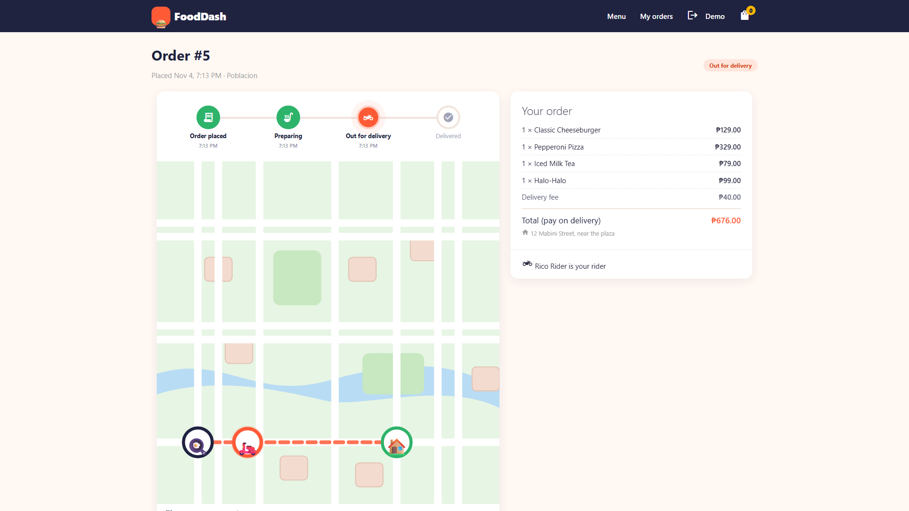

## Features

**Customer**
- Menu with categories, search and product cards (emoji or uploaded photo)
- Cart in a modal: add, change quantity, empty cart (session based)
- Register and log in from modals, password hashing, CSRF protection
- Checkout modal with delivery area, address, phone and rider note (pay on delivery)
- **Live tracking page**: status timeline, rider name and a map pin that moves every few seconds
- Order history and "cancel order" while the kitchen has not started

**Admin**
- Dashboard: orders today, sales today, open orders, dishes on the menu
- **Orders board** (New, Preparing, Out for delivery, Finished) with one-click status buttons
- "Send out" opens a modal to choose the rider
- Products and categories CRUD in modals, photo upload, hide/show dishes
- Users: add riders and admins
- Sales report with date range, top dishes and a print-ready layout

**Rider**
- Sees the orders assigned to them with a route map
- "Start delivery (simulate GPS)" walks the route and posts positions to the server. A real phone would post `navigator.geolocation` coordinates to the same endpoint.

**Custom framework ("Bite")**: front controller, router with route groups and middleware, request/response objects, controllers, models, PDO wrapper with transactions, validator, session flash messages, CSRF middleware, view layouts and partials.

**UI feedback**: forms open in **modals**, deletes and status changes use **confirmation dialogs**, and every success or failure shows a **toast alert** (for example "Order #12 placed!" or "Mango Float was deleted.").

## Snapshots

| | |
|---|---|
| 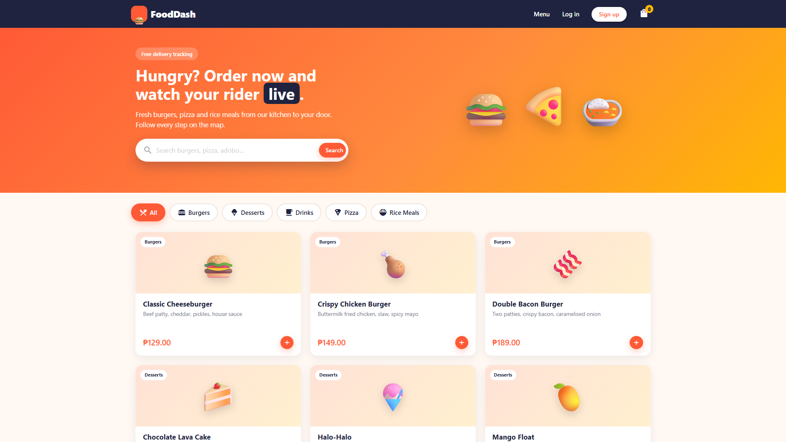 **Menu** | 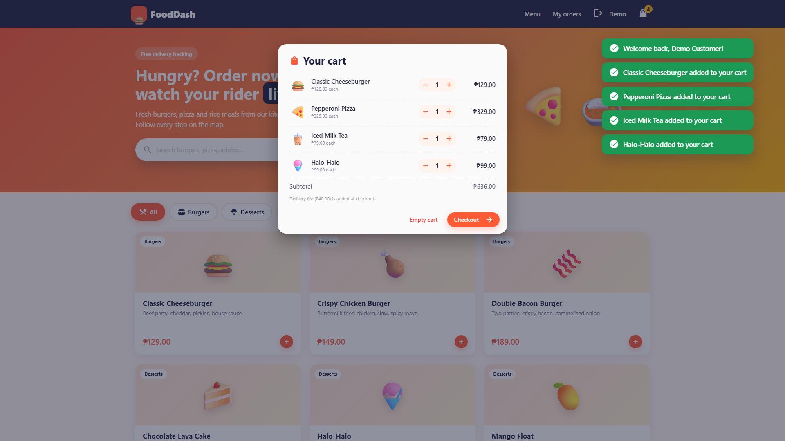 **Cart modal** |
| 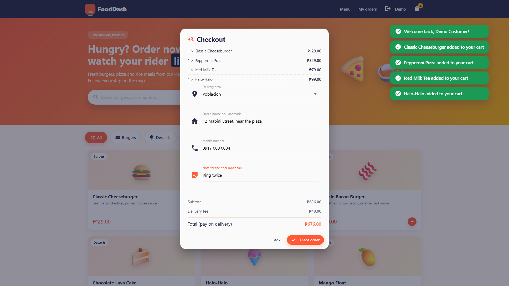 **Checkout modal** | 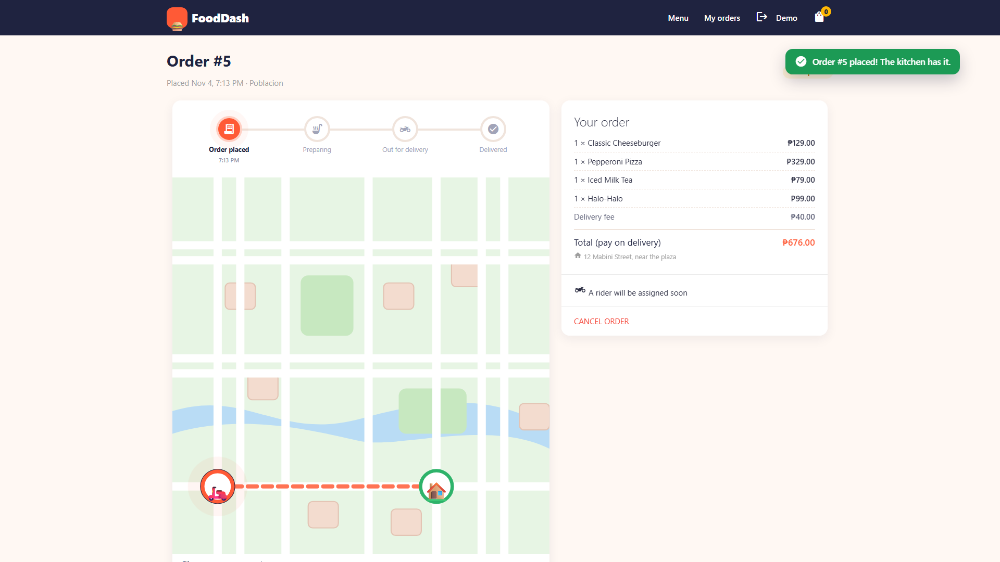 **Success alert and tracking** |
| 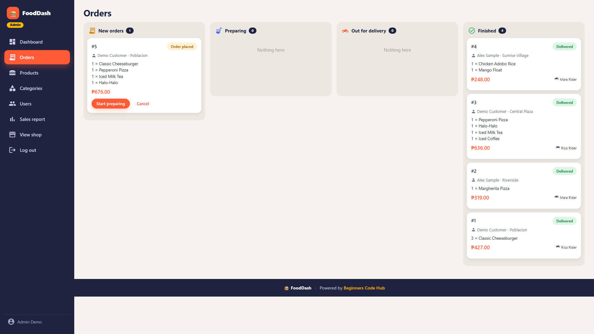 **Admin orders board** | 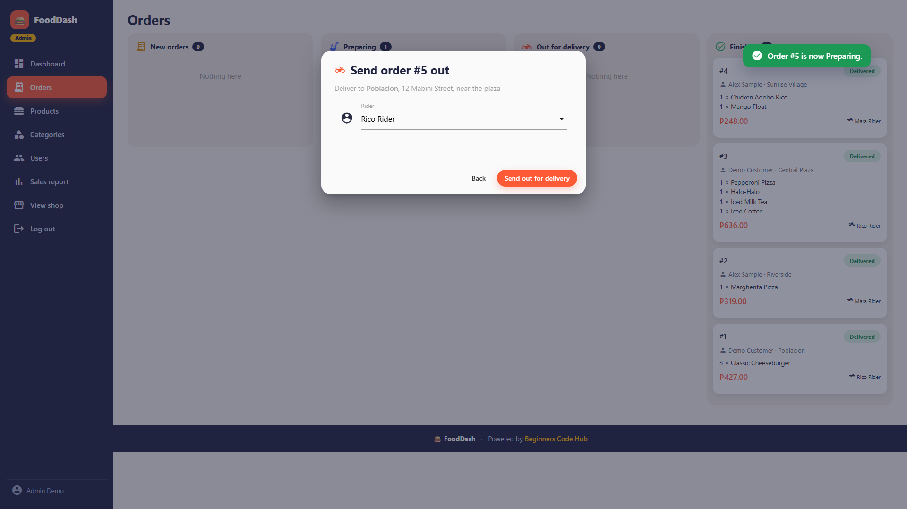 **Send out: choose a rider** |
| 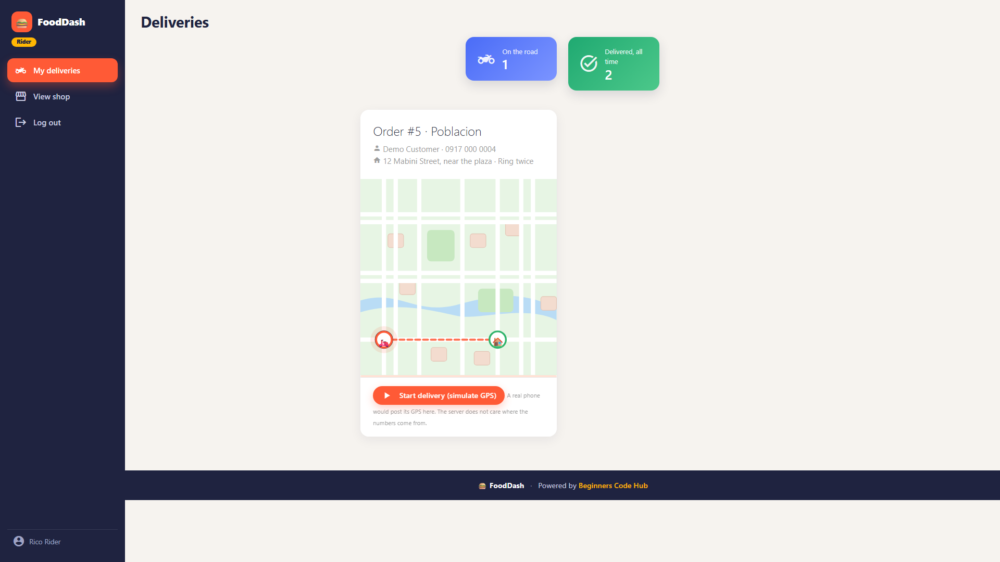 **Rider page** | 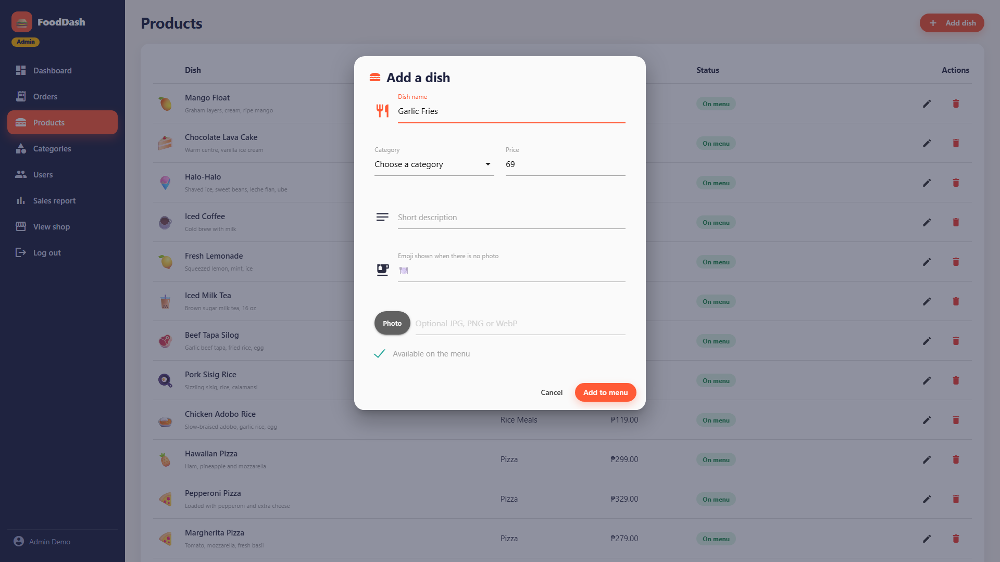 **Product form in a modal** |
| 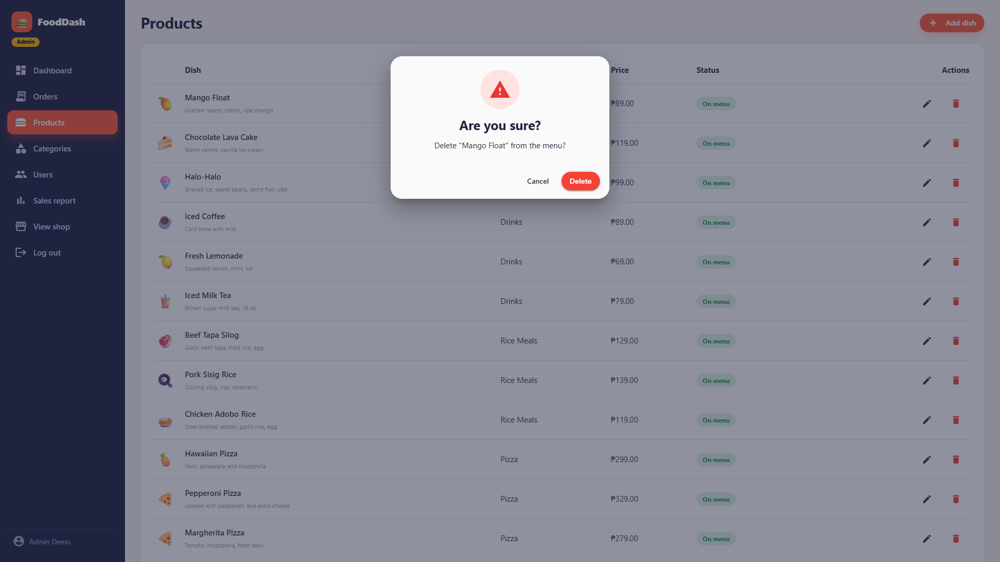 **Confirmation dialog** | 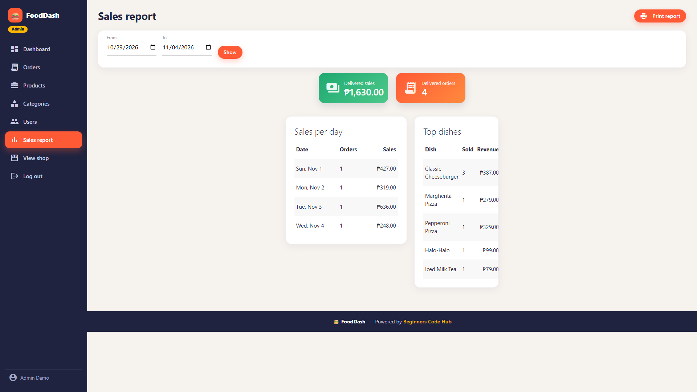 **Sales report** |

## Tech stack

| Layer | What |
|---|---|
| Language | PHP 8.2+ (strict types, no framework, no Composer) |
| Database | MySQL 5.7+/8 or MariaDB 10.4+ (XAMPP works), PDO with prepared statements |
| UI | Materialize CSS 1.0 (MIT, bundled in `public/assets/vendor/`), Material Icons font, vanilla JavaScript (`fetch`) |
| Live tracking | The page polls a JSON endpoint every 3 seconds (no websockets needed) |

## Requirements

- XAMPP (or any PHP 8.2+ with `pdo_mysql`, plus MySQL/MariaDB)
- A browser. Nothing to install with Composer or npm.

## How to run

### Option A: XAMPP (recommended for students)
1. Start **Apache** and **MySQL** in the XAMPP Control Panel.
2. Copy this folder to `C:\xampp\htdocs\fooddash`.
3. Create the database and demo data (pick one):
   - Terminal: `C:\xampp\php\php.exe database\install.php`
   - or phpMyAdmin: import `database/schema.sql`, then `database/seed.sql`.
4. Check `config/config.php`. XAMPP defaults are already set: host `127.0.0.1`, port `3306`, user `root`, empty password.
5. Open <http://localhost/fooddash/public/>.

### Option B: PHP's built-in server
```bash
php database/install.php
php -S localhost:8000 -t public
```
Open <http://localhost:8000>.

### Demo accounts (password for all: `Demo@1234`)
| Role | Email |
|---|---|
| Admin | `admin@example.com` |
| Rider | `rider@example.com`, `rider2@example.com` |
| Customer | `demo@example.com`, `alex@example.com` |

### Try the live tracking in 2 minutes
1. Window 1: log in as `demo@example.com`, add dishes, **Checkout**, place the order.
2. Window 2 (private window): log in as `admin@example.com`, **Orders**, click **Start preparing**, then **Send out** and choose Rico Rider.
3. Window 3 (private window): log in as `rider@example.com`, open **My deliveries**, click **Start delivery**.
4. Watch window 1. The status timeline updates and the pin travels to the house, with no refresh.

### Run the automated check
```bash
php -S localhost:8000 -t public      # terminal 1
php tests/smoke.php                  # terminal 2: 45 checks over HTTP
php database/install.php             # reset the demo data afterwards
```

## Folder structure

```
fooddash/
  config/config.php          database, currency, order statuses, delivery areas, kitchen position
  core/                      the framework
    bootstrap.php            autoloader + boot
    App.php Router.php Request.php Response.php
    Controller.php Model.php View.php DB.php
    Validator.php Session.php Csrf.php Auth.php helpers.php
  app/
    Controllers/             MenuController, CartController, AuthController, CheckoutController,
                             OrderController, RiderController, Admin/*
    Models/                  User, Category, Product, Order
    Middleware/              RequireLogin, RequireAdmin, RequireRider
    Services/Cart.php        session cart (prices always read from the database)
    Views/                   layouts/, menu/, cart/, auth/, checkout/, orders/, admin/, rider/, partials/, errors/
  routes/web.php             every URL of the app in one file
  database/                  schema.sql, seed.sql, install.php
  public/                    web root: index.php (front controller), .htaccess, uploads/
    assets/css/app.css       theme on top of Materialize
    assets/js/               app.js (modals, forms, dialogs, toasts, cart), track.js, rider.js
    assets/vendor/           Materialize CSS/JS and the Material Icons font (local, works offline)
  tests/smoke.php            end-to-end check
  docs/screenshots/          the images in this README
```

## Framework tour

**Request lifecycle**
`public/index.php` -> `core/bootstrap.php` (autoload, config, session) -> `App::run()` -> `Request::capture()` -> `Router::dispatch()` -> CSRF middleware -> route middleware (`RequireLogin`, `RequireAdmin`...) -> controller method -> `Response` (HTML or JSON) -> browser.

**Add a page in three steps**
1. Route, in `routes/web.php`:
   ```php
   $router->get('/about', [PageController::class, 'about']);
   ```
2. Controller, in `app/Controllers/PageController.php`:
   ```php
   final class PageController extends Core\Controller
   {
       public function about(): Core\Response
       {
           return $this->page('pages/about', ['title' => 'About us']);
       }
   }
   ```
3. View, in `app/Views/pages/about.php`: plain PHP and HTML. Print values with `<?= e($value) ?>`.

**Add a form that opens in a modal**
- The link: `<a href="#" data-modal="<?= url('/admin/categories/create') ?>">New</a>`
- The form view starts with `<form data-ajax action="..." method="post">` and has `<span data-error="name"></span>` slots under each field.
- The controller returns `$this->modal('admin/categories/form')` for the form and `$this->success('Category created.', ['reload' => true])` after saving. Validation errors come back as JSON and `app.js` shows them under the fields. The success message appears as a toast after the page reloads.

**Add a confirmation dialog**
```html
<button data-confirm="Delete this dish?" data-url="/admin/products/5" data-method="DELETE"
        data-yes="Delete" data-tone="danger">Delete</button>
```

**Validation**
```php
$data = $this->validate(['email' => 'required|email|unique:users,email', 'password' => 'required|min:8|confirmed']);
```
Rules: `required`, `email`, `min:n`, `max:n`, `numeric`, `positive`, `in:a,b`, `confirmed`, `unique:table,column`.

**Database helpers**
`DB::all()`, `DB::one()`, `DB::value()`, `DB::insert()`, `DB::update()`, `DB::delete()`, `DB::transaction(fn)`. Every value goes through a prepared statement.

## Security notes

- Prepared statements everywhere (SQL injection).
- Output escaped with `e()` (XSS).
- CSRF token on every POST, PUT and DELETE.
- `password_hash` / `password_verify`, and the session id is regenerated at login.
- Prices are copied from the database at checkout, never trusted from the browser.
- Customers only see their own orders: every order query filters `AND user_id = ?`.
- Orders only move along allowed steps (`pending -> preparing -> out_for_delivery -> delivered`).
- Before going online: set `'debug' => false`, use a database user that is not `root`, and serve over HTTPS.

## Troubleshooting

| Problem | Fix |
|---|---|
| `SQLSTATE[HY000] [1045] Access denied for user 'root'@'localhost'` | PHP reached MySQL but the user or password in `config/config.php` is wrong. XAMPP's `root` normally has an empty password. |
| `SQLSTATE[HY000] [2002]` connection refused | MySQL is not running (start it in XAMPP) or the port is not 3306. |
| `SQLSTATE[HY000] [1049] Unknown database` | Run `php database/install.php` or import `schema.sql`. |
| `could not find driver` | Enable `extension=pdo_mysql` in `php.ini`, then restart Apache. |
| Pages show 404 under XAMPP | Open `/fooddash/public/`, and make sure `mod_rewrite` is on (it is by default). |
| Photo upload does nothing | The `public/uploads/` folder must be writable. |
| Want fresh demo data | `php database/install.php` (drops and recreates the tables). |

## Credits

- Built by **Beginners Code Hub** (powered by Beginners Code Hub).
- [Materialize CSS](https://materializecss.com/) (MIT license) and the Material Icons font (Apache 2.0).
- All names, emails and orders in the demo data are fake.

## License

Free to use for learning and for your own projects. Please keep the "Powered by Beginners Code Hub" footer if you share it.
